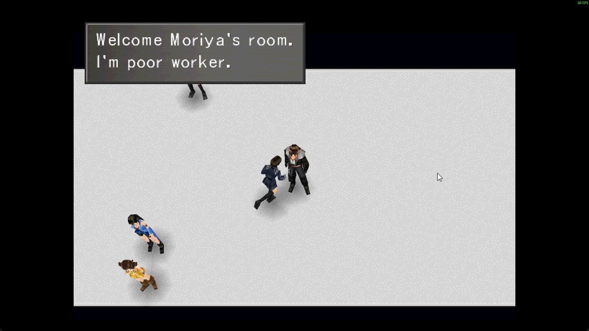
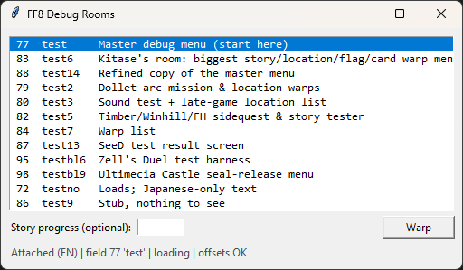

# FF8 Debug Rooms

Warp a running **Final Fantasy VIII** PC game (2013 Steam, EN/FR) to the developer debug rooms.

1. Download `FF8DebugRooms.exe` from [Releases](../../releases).
2. Start FF8 and load a save. Walk around on a normal field (i.e. not the world map). Menu must be closed. Must not be in a battle.
3. Pick a room and click **Warp** (or double-click it). `test` is the master debug menu and `test6` is the biggest one.

**Not tested on FR** (yet)

**Story progress** (optional) sets savemap var 256 to the entered value upon clicking Warp, for testing story-gated content.

Only rooms that load are listed. The others (`start`, `test1`, `test4`, `test8`, `testbl0/5/7/8/13/14`, `testmv`) crash the game.

## Build

- Local: `build.bat` puts the exe in `dist\FF8DebugRooms.exe`.
- CI: push a tag (`git tag v1.0.0 && git push origin v1.0.0`) and the GitHub Action builds the exe and
  attaches it to a release. Running the workflow by hand from the Actions tab builds the exe as a
  downloadable artifact instead.

## Files

- `debug_room_app.py`: the tkinter GUI.
- `field_warp.py`: the warp logic. Also usable as a CLI: `python field_warp.py read | verify | warp test`.
- `maplist`: the game's field-id to field-name list, bundled into the exe.
